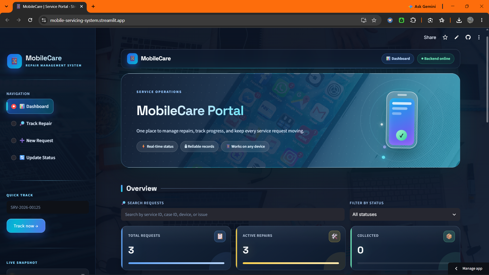
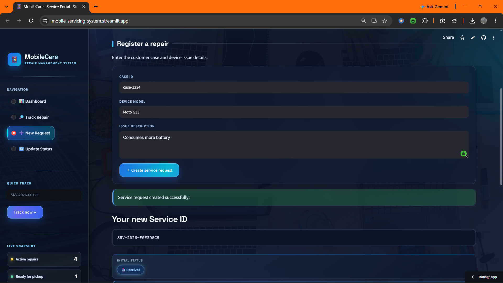
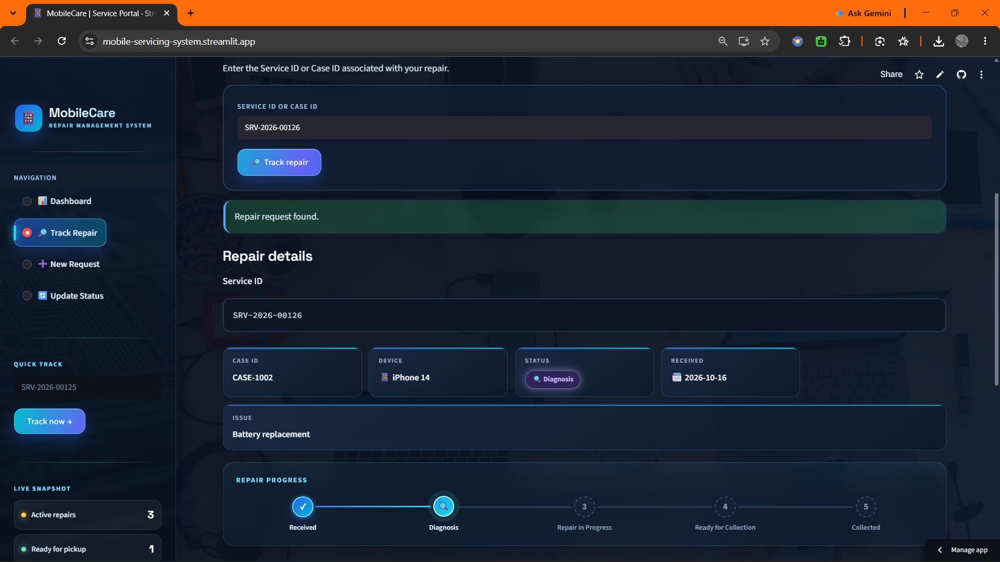
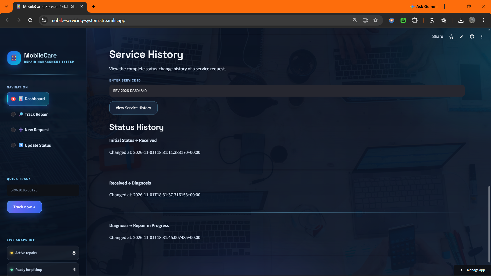

# Mobile Servicing System

A full-stack mobile phone servicing management application built with
**Python, FastAPI, Streamlit, and SQLite**.

## 🌐 Live Demo

-   **Live Application:** [Mobile Servicing
    System](https://mobile-servicing-system.streamlit.app/)
-   **Backend API Documentation:** [FastAPI Swagger
    UI](https://mobile-servicing-system-api.onrender.com/docs)
-   **GitHub Repository:**
    [SaiKalyan738/mobile-servicing-system](https://github.com/SaiKalyan738/mobile-servicing-system)

The application is publicly accessible and does not require users to log
in. This is a portfolio demonstration project hosted on free-tier
services.


## 1. Project Overview

The Mobile Servicing System helps manage mobile phone repair requests
and track their repair progress.

Customers can track service requests using a **Service ID** or **Case
ID**. The application also maintains a service status history to record
changes throughout the repair process.

## 2. Technologies Used

| Technology | Purpose |
|---|---|
| Python | Backend programming and Application logic |
| FastAPI | REST API development |
| Streamlit | Frontend User Interface |
| SQLite | Database Management and Data Storage |
| Pydantic | Request Data Validation |
| Requests | Frontend API Communication |
| Pytest | Automated Testing |
| Uvicorn | Running the FastAPI Backend Server |

## 3. Main Features

-   Create mobile service requests.
-   Generate unique Service IDs.
-   Track services using Service ID or Case ID.
-   View all service requests.
-   Update repair status.
-   Validate repair status transitions.
-   Maintain service status history.
-   Display service dashboard information.
-   Automated API testing.

## 4. Repair Status Workflow

The application follows this status sequence:

**Received → Diagnosis → Repair in Progress → Ready for Collection →
Collected**

Invalid status transitions are rejected.

## 5. Project Structure

``` text
MOBILE SERVICING SYSTEM/
├── backend/
│   ├── main.py
│   ├── database.py
│   ├── seed_data.py
│   ├── tracking.py
│   └── mobile_servicing.db
├── frontend/
│   └── app.py
├── tests/
│   └── test_api.py
├── screenshots/
│   ├── dashboard.png
│   ├── create-service.png
│   ├── track-service.png
│   └── service-history.png
├── requirements.txt
└── README.md
```

## 6. Installation

### Clone the repository

``` bash
git clone https://github.com/SaiKalyan738/mobile-servicing-system.git
cd "mobile-servicing-system"
```

### Create and activate a virtual environment

**Windows Command Prompt:**

``` bat
python -m venv .venv
.venv\Scripts\activate.bat
```

**macOS / Linux:**

``` bash
python3 -m venv .venv
source .venv/bin/activate
```

### Install dependencies

``` bash
python -m pip install -r requirements.txt
```

## 7. Run the Application Locally

Open two terminals from the project root and activate the virtual
environment in each.

### Terminal 1 --- Start the FastAPI backend

``` bash
python -m uvicorn backend.main:app --reload
```

API documentation: <http://127.0.0.1:8000/docs>

### Terminal 2 --- Start the Streamlit frontend

``` bash
python -m streamlit run frontend/app.py
```

Streamlit will display the local application URL in the terminal,
usually `http://localhost:8501`.

## 8. Database

The project uses SQLite.

Main database tables:

### `service_requests`

-   Service ID
-   Case ID
-   Device model
-   Issue description
-   Current status
-   Received date

### `service_status_history`

-   Service ID
-   Old status
-   New status
-   Changed timestamp

## 9. API Endpoints
| Method | Endpoint | Purpose |
|---|---|---|
| GET | `/` | API welcome message |
| GET | `/health` | Health check |
| GET | `/track/{identifier}` | Track a service |
| GET | `/services` | View service requests |
| POST | `/services` | Create a service request |
| PATCH | `/services/{service_id}/status` | Update repair status |
| GET | `/services/{service_id}/history` | View service history |

For the interactive API documentation, visit the [live Swagger
UI](https://mobile-servicing-system-api.onrender.com/docs).

## 10. Automated Testing

Run the tests from the project root:

``` bash
python -m pytest -v
```


## 11. Application Screenshots


### Dashboard



### Create Service Request



### Track Service



### Service History



## 12. Learning Outcomes

Through this project, I gained practical knowledge in the listed below:

-   Python application development.
-   REST API development using FastAPI.
-   Frontend development using Streamlit.
-   SQLite database operations.
-   API integration.
-   Data validation.
-   Status transition validation.
-   Audit logging.
-   Automated testing using pytest.
-   Error handling.

## 13. Future Improvements

-   Add authentication and role-based access for staff/admin users.
-   Move to a persistent hosted database for reliable long-term data
    storage.
-   Add stronger API security and rate limiting.
-   Improve deployment monitoring and error logging.

------------------------------------------------------------------------

**Note:** This application is intended as a learning and portfolio
demonstration project. Avoid entering real customer personal or
sensitive information.
